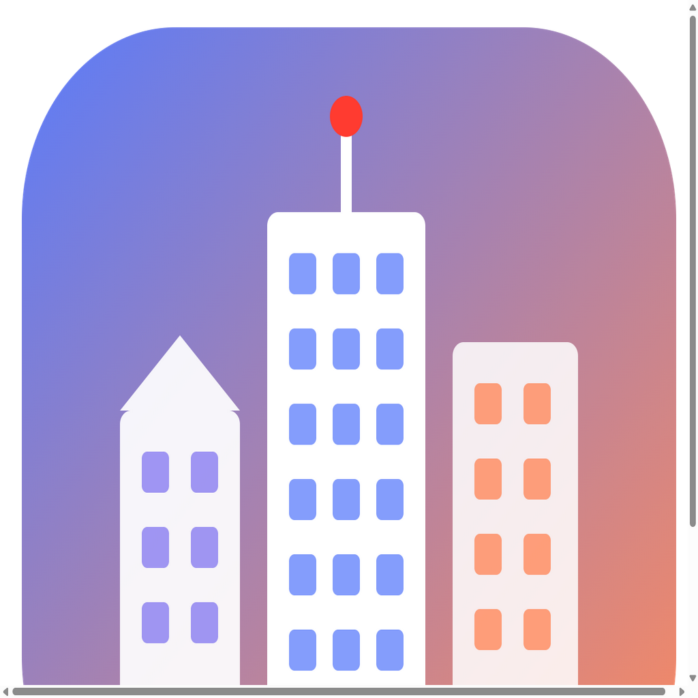
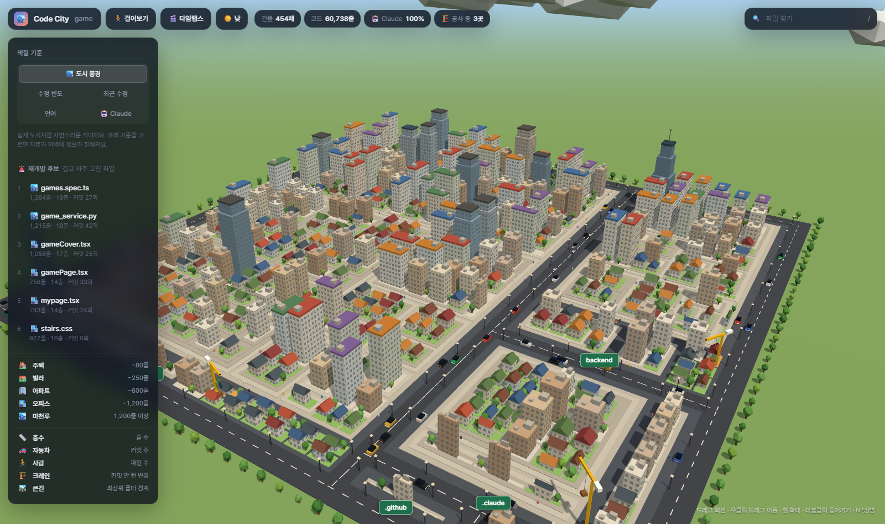
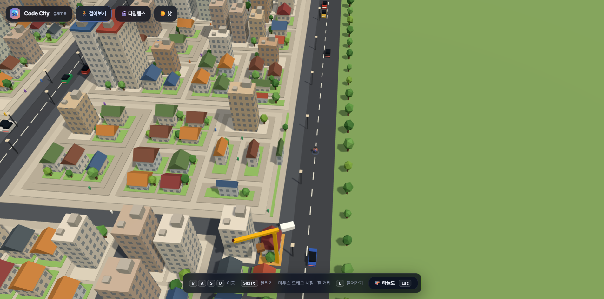
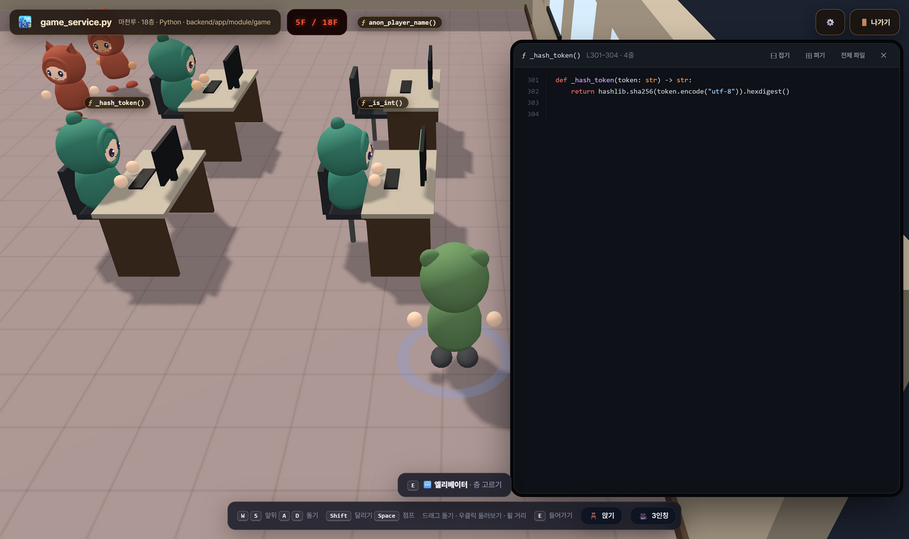

<p align="center">
  
</p>

<h1 align="center">Repopolis</h1>

<p align="center">
  프로젝트 폴더를 <b>살아 움직이는 3D 도시</b>로 보여 주는 데스크톱 앱.<br>
  파일은 건물, 폴더는 구역, 커밋은 자동차 — 커밋하면 건물이 올라갑니다.
</p>

<p align="center">
  
  
  
  <a href="LICENSE"></a>
</p>

<p align="center">
  
</p>

---

## 주요 기능

| | |
|---|---|
| **도시로 보기** | 파일 하나가 건물 하나. 줄 수에 따라 🏠 주택 → 🏘️ 빌라 → 🏢 아파트 → 🏬 오피스 → 🏙️ 마천루로 커지고, 최상위 폴더는 큰길 · 2단 폴더는 골목으로 나뉩니다 |
| **🚶 걸어보기** | 곰귀 후드를 쓴 캐릭터가 되어 보도에서 출발해 도시를 걸어 다닙니다(행인 · 건물 안 직원도 같은 꼬마들로, 후드 색 · 귀 모양이 다릅니다). 화면은 캐릭터가 바라보는 쪽을 따라가고, 1인칭 · 3인칭을 바꿀 수 있습니다. 건물과 부딪히고, 가까운 건물에 `E` 로 들어갑니다 |
| **🚪 건물 들어가기** | 층마다 걸어 다니는 사무실이 됩니다. 그 층 줄 범위의 함수는 모니터 책상, 클래스는 유리 회의실, 컴포넌트는 진열장, 메서드는 노트북 원탁, 타입은 설계도 액자, 스타일은 색 견본판으로 놓이고, 다가가 `E`(또는 클릭)를 누르면 옆 패널에 그 부분 코드가 뜹니다(접기 · 전체 파일 보기). 엘리베이터로 층을 고르거나 계단으로 오르내리고, 1층 안내 데스크에서 건물 소개 · 층별 안내를 봅니다. 낮 · 최근 커밋이 많은 건물일수록 사람이 북적입니다 |
| **🚦 거리** | 큰길 교차로에 신호등 · 횡단보도가 있어 차는 신호를 지키고 앞차와 간격을 두며, 사람은 초록불에 길을 건넙니다. 밤이 깊으면 사람들이 건물로 들어가고, 해와 달이 시각대로 하늘을 가로지릅니다 |
| **🏘️ 거리 풍경** | 건물마다 창 모양 · 지붕 · 층 구성 · 색이 달라지고, 문 · 상가 차양 · 옥상 실외기, 벤치 · 휴지통 · 소화전 · 화분, 바람에 흔들리는 나무, 장난감 차, 날아다니는 새 떼와 어슬렁거리는 고양이가 있습니다 |
| **실시간** | 새 커밋(Claude Code 자동 커밋 포함)이 생기면 🎉 "준공!" 알림과 함께 건물이 자라고, 커밋 안 된 수정 · 새 파일 옆에는 🏗️ 크레인이 섭니다 |
| **🎬 타임랩스** | 첫 커밋부터 도시가 지어지는 과정을 재생합니다. 바뀐 건물은 노랗게 번쩍입니다 |
| **🌗 낮 · 밤** | 실제 시간을 따라갑니다(17:30~19:00 노을, 밤에는 창문 · 가로등 · 헤드라이트). 버튼이나 `N` 으로 고정 |
| **색칠 기준** | 도시 풍경(기본) · 수정 빈도 · 최근 수정 · 언어 · 🤖 Claude 커밋 비율 · 👤 주인(가장 많이 바꾼 사람, 여럿이 나눠 가지면 흐리게) · 🐞 버그 수정(fix · bug · 버그 · 오류 커밋이 손댄 횟수) |
| **🔗 관계** | 건물을 고르면 **함께 바뀌는 파일**(같은 커밋에 자주 같이 들어감 — 함께 바뀐 커밋 ÷ 두 파일 커밋 수 평균, 3번 · 30% 이상, 20개 넘게 바뀐 커밋은 제외), 이 파일이 **쓰는 곳 · 쓰이는 곳**(import)으로 아치가 뻗고 나머지는 흐려집니다. import 없이 함께 바뀌면 **숨은 의존**으로 표시 |
| **👥 소유 · 버스 팩터** | 파일마다 주인과 지분, 손댄 사람 수, 최근 90일 변경량. 구역에 마우스를 올리면 그 구역의 주인과 버스 팩터(몇 명이 빠지면 절반 넘는 파일이 주인을 잃는지) |
| **📸 저장** | 지금 화면을 PNG 로 저장 |
| **⚙️ 설정** | 🎵 배경음악(낮 · 밤에 따라 분위기가 바뀜) · 🔔 효과음(발소리 · 문 · 엘리베이터) · 🐦 주변 소리(새 · 귀뚜라미)를 각각 켜고 끄고 음량을 조절합니다. 버튼 · 글자 크기(자동이면 창이 작아질수록 같이 줄어듦)와, 앱에서는 창 크기(작게 · 보통 · 크게 · 최대화 · 전체 화면)도 고릅니다. 앱은 마지막 창 크기 · 위치를 기억합니다 |
| **🚨 재개발 후보** | 길고 자주 고친 파일(`줄 수 × log(커밋 수)`) 상위 목록. 문서 · 설정 파일은 뺍니다 |
| **찾기** | `/` 로 파일 이름 검색, 건물 클릭 → 상세 정보 · 파일 열기, 폴더 바닥 클릭 → 그 구역으로 확대 |

<p align="center">
  
  
</p>

### 도시 읽는 법

| 도시 | 코드 |
|---|---|
| 건물 종류 · 층수 | 줄 수 (~80 / ~250 / ~600 / ~1200 / 그 이상) |
| 건물 폭 | 함수 개수 (조금) |
| 큰길 / 골목 / 블록 | 최상위 폴더 / 2단 폴더 / 더 깊은 폴더 |
| 🚗 자동차 수 | 커밋 수 |
| 🚶 사람 수 | 파일 수 |
| 🏗️ 크레인 | 커밋 안 된 변경 |

## 조작

| 어디서 | 키 · 마우스 | 동작 |
|---|---|---|
| 하늘에서 | 드래그 · 우클릭 드래그 · 휠 | 회전 · 이동 · 확대 (화면 가운데 보이는 곳이 기준) |
| | 클릭 / 더블클릭 | 건물 정보 / 들어가기 |
| | `/` · `Space` · `N` · `L` · `Esc` | 검색 · 타임랩스 · 낮밤 · 폴더 이름표 · 선택 해제 |
| 걸을 때 | `W` `S` · `A` `D` (또는 방향키) · `Shift` · `Space` · `C` | 앞뒤 · 몸 돌리기 · 달리기 · 점프 · 앉기(가까운 벤치 · 의자 · 소파, 없으면 바닥) |
| | 마우스 드래그 · 우클릭 드래그 | 좌우로 몸 돌리기 · 위아래로 시선 / 캐릭터 주위 둘러보기 (놓으면 등 뒤로) |
| | 휠 · `V` | 카메라 거리 (끝까지 당기면 1인칭) · 1인칭 / 3인칭 |
| | `E` · `Esc` | 가까운 건물 들어가기 · 하늘로 |
| 건물 안 | 걷기와 같음 · `E` | 가까운 요소 코드 보기 · 엘리베이터 · 계단 · 안내 데스크 · 출입문 |
| | `Esc` | 열린 패널 닫기 → 다 닫혀 있으면 건물 밖으로 |

## 설치

[Releases](https://github.com/Eehnodu/repopolis/releases/latest) 에서 내 컴퓨터에 맞는 파일을 받습니다.

| 컴퓨터 | 파일 |
|---|---|
| Windows (64비트) | `Repopolis-windows.exe` — 설치 없이 바로 실행되는 파일 하나 |
| Mac (M1 이후, Apple silicon) | `Repopolis-macos-arm64.zip` |
| Mac (Intel) | `Repopolis-macos-x64.zip` |

- **Windows** — 더블클릭. "Windows의 PC 보호" 창이 뜨면 **추가 정보 → 실행** (서명하지 않은 개인 앱이라 뜹니다)
- **Mac** — zip 을 풀어 `Repopolis` 를 **응용 프로그램** 폴더로 옮긴 뒤 더블클릭. 처음 한 번 막히면 **시스템 설정 → 개인정보 보호 및 보안** 아래쪽 **그래도 열기** 를 누릅니다 (애플 인증을 받지 않은 앱이라서)

앱을 열고 프로젝트 폴더를 고르거나 창에 끌어다 놓으면 도시가 지어집니다. 다음부터는 마지막 프로젝트가 바로 열리고, 위쪽 `📂 프로젝트` 로 바꿉니다.

## 알아 둘 것

- 커밋 · 타임랩스 · 크레인 같은 git 정보는 컴퓨터에 **git** 이 깔려 있어야 나옵니다. git 저장소가 아닌 폴더도 도시는 지어집니다
- git 저장소면 `.gitignore` 를 따르고, 아직 커밋 안 한 새 파일도 포함합니다
- 기본으로 빼는 것: `node_modules` · 빌드 결과 · lock 파일 · 이미지 같은 바이너리 · 인증서 · 1MB 넘는 파일 · `.md` `.txt` 같은 문서 파일 · 심볼릭 링크(저장소 밖 파일을 읽지 않게)
- 남이 만든 저장소를 열어도 안전하게: `.git/config` 에 명령을 실행하는 설정(fsmonitor · filter · textconv · include 등)이 있으면 git 기록 없이 짓고, "파일 열기"는 VS Code 가 있으면 VS Code 로, 없으면 실행될 수 있는 파일(.js · .bat · .ps1 …)은 폴더에서 보여 주기만 합니다
- 앱이 커밋 · 수정을 보고 도시를 다시 그려도 걷던 자리 · 들어가 있던 층 · 열어 둔 코드는 그대로 돌아옵니다
- 타임랩스의 과거 줄 수는 `git log --numstat` 누적치로 추정합니다. 이름이 바뀐 파일은 그 시점에 새로 생긴 것으로 보이고, 지금은 지워진 파일은 나오지 않습니다
- 앱은 3D 엔진(three.js)과 코드 색칠(highlight.js)을 앱 안에 담고 있어 인터넷 없이 돕니다. 아래 **브라우저용 HTML** 은 이것들을 CDN 에서 받으므로 인터넷이 필요합니다

## 개발

Node.js 22 기준.

```bash
npm install     # postinstall 이 three.js · highlight.js 를 app/vendor 로 복사
npm start       # 앱 실행
```

### 브라우저용 HTML 한 장 (scan.js)

```bash
node scan.js <프로젝트 경로>                     # → output/<이름>.html 을 만들고 브라우저로 연다
node scan.js ../game -x "zz_*" -x "*.test.ts"     # 패턴 제외 (여러 번 가능)
node scan.js ../game -o city.html --no-open
node scan.js ../game --docs                       # 문서 파일도 건물로
node scan.js ../game --no-source                  # HTML 에 코드 원문을 넣지 않음 (건물 안 코드 보기 불가)
```

HTML 주소 뒤에 `#mode=claude&time=120&select=gamePage&sky=night` 처럼 붙이면 특정 화면을 바로 엽니다.

### 구조

```
scan.js            폴더 + git 기록 → 도시 데이터 · HTML (CLI 겸 모듈)
viewer.html        3D 도시 (three.js) — 브라우저와 앱이 같이 씀
app/main.js        Electron 앱: 프로젝트 열기, 실시간 감시(.git/logs/HEAD · git status 12초마다), 다시 짓기
app/launcher.html  시작 화면 (최근 프로젝트)
scripts/vendor.js  라이브러리를 app/vendor 로 복사
build/icon.png     앱 아이콘 (1024px)
```

## 빌드 · 배포

설치 파일은 이 PC 가 아니라 **GitHub Actions** 에서 만듭니다 (`.github/workflows/release.yml`).

```bash
# package.json 의 version 을 올린 뒤
git tag v1.0.1
git push origin v1.0.1
```

`v*` 태그를 올리면 Windows · macOS 러너가 각각 빌드하고, 결과 파일을 그 태그의 Release 에 붙입니다. Actions 탭에서 손으로 돌리면(workflow_dispatch) 빌드 · 점검만 하고 Release 는 만들지 않습니다.

로컬에서 직접 만들려면 `npm run dist:win` / `npm run dist:mac` (결과는 `dist/`).

## 라이선스

MIT. 앱에 담긴 three.js(MIT) · highlight.js(BSD-3-Clause)는 각자의 라이선스를 따릅니다.
