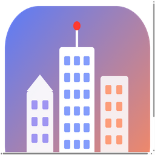
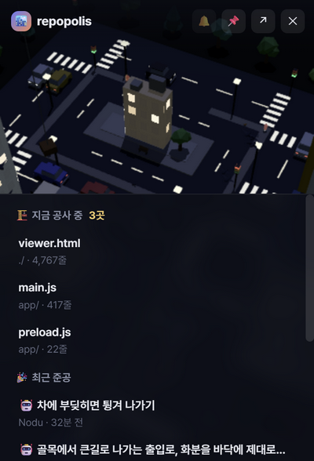

<p align="center"></p>
<h1 align="center">Repopolis</h1>
<p align="center">프로젝트 폴더를 살아 움직이는 3D 도시로 보여 주는 데스크톱 앱 (Windows · macOS)</p>

파일은 건물, 폴더는 구역, 커밋은 자동차가 됩니다. 커밋하면 건물이 올라가고, 저장하면 공사가 시작됩니다.

<p align="center"></p>

## 주요 기능

- 도시 보기: 줄 수만큼 높은 건물, 폴더별 큰길 · 골목 · 블록, 커밋 수만큼 자동차, 파일 수만큼 사람
- 타임랩스: 첫 커밋부터 도시가 지어지는 과정을 재생
- 색칠 기준: 도시 풍경 · 수정 빈도 · 최근 수정 · 언어 · Claude 커밋 비율 · 주인 · 버그 수정
- 관계: 함께 바뀌는 파일, import 로 쓰는 곳 · 쓰이는 곳을 아치로 표시
- 소유 · 버스 팩터, 재개발 후보(길고 자주 고친 파일) 목록
- 걸어보기: 캐릭터로 거리를 걷고, 건물에 들어가 층마다 함수 · 클래스 · 타입의 코드를 봄
- 실시간 반영: 파일을 저장하면 크레인 · 인부가 서고, 커밋하면 건물이 완공됨
- 트레이 · 알림: 창을 닫아도 트레이에서 공사 현황을 보여 주고 알림을 띄움
- 낮 · 밤(실제 시간 따라감), 파일 검색, 화면 PNG 저장, 배경음악 · 효과음
- 새 버전 확인: 켤 때와 6시간마다 GitHub 최신 Release 를 확인하고, 물어본 뒤 바꿈

## 화면

<p align="center">
  
  
</p>
<p align="center"></p>

## 내려받기

[Releases](https://github.com/Eehnodu/repopolis/releases/latest) 에서 내 컴퓨터용 파일을 받습니다.

| 컴퓨터 | 파일 |
|---|---|
| Windows 10 · 11 (64비트) | `Repopolis-windows.exe` (설치 없이 바로 실행) |
| Mac (Apple silicon) | `Repopolis-macos-arm64.zip` |
| Mac (Intel) | `Repopolis-macos-x64.zip` |

- Windows: 더블클릭합니다. "Windows의 PC 보호" 창이 뜨면 추가 정보 → 실행. 서명하지 않은 개인 앱이라 뜹니다.
- Mac: zip 을 풀어 `Repopolis` 를 응용 프로그램 폴더로 옮기고 엽니다. 처음에 막히면 시스템 설정 → 개인정보 보호 및 보안 → 그래도 열기.

## 쓰는 법

1. 프로젝트 폴더를 고르거나 창에 끌어다 놓으면 도시가 지어집니다.
2. 건물을 클릭하면 정보, 더블클릭하면 안으로 들어갑니다.
3. 걸어보기로 내려가 건물 앞에서 `E` 를 누르면 그 파일 안으로 들어갑니다.

다음부터는 마지막 프로젝트가 바로 열립니다. 창을 닫아도 트레이에 남고, 완전히 끄려면 트레이 아이콘 오른쪽 클릭 → 끝내기.

| 어디서 | 키 · 마우스 | 하는 일 |
|---|---|---|
| 하늘 | 드래그 · 우클릭 드래그 · 휠 | 회전 · 이동 · 확대 |
| | `/` · `Space` · `N` · `L` · `Esc` | 검색 · 타임랩스 · 낮밤 · 폴더 이름표 · 선택 해제 |
| 걸을 때 | `W` `S` · `A` `D` (방향키) | 앞뒤 · 몸 돌리기 |
| | `Shift` · `Space` · `C` | 달리기 · 점프 · 앉기 |
| | 휠 · `V` | 카메라 거리 · 1인칭 / 3인칭 |
| | `E` · `Esc` | 건물 들어가기 · 하늘로 |
| 건물 안 | `E` · `Esc` | 코드 보기 · 엘리베이터 · 계단 / 패널 닫기 · 밖으로 |

### 알아 둘 것

- 커밋 · 타임랩스 · 실시간 반영은 git 저장소에서만 나옵니다. git 저장소가 아닌 폴더도 도시는 지어집니다.
- `.gitignore` 를 따릅니다. `node_modules` · 빌드 결과 · lock 파일 · 바이너리 · `.env` 같은 비밀 설정 · 1MB 넘는 파일 · 문서 파일은 뺍니다.
- `.git/config` 에 명령을 실행하는 설정(fsmonitor · filter 등)이 있는 저장소는 git 기록 없이 짓습니다.
- 앱은 three.js · highlight.js 를 안에 담고 있어 인터넷 없이 돕니다. 브라우저용 HTML 은 이 둘을 CDN 에서 받습니다.

## 직접 실행 · 빌드

Node.js 22 기준입니다.

```bash
npm install         # three.js · highlight.js 를 app/vendor 로 복사
npm start           # 앱 실행
npm run dist:win    # Windows 실행 파일 (dist/)
npm run dist:mac    # macOS 앱 (dist/)
```

앱 없이 브라우저용 HTML 한 장으로 만들 수도 있습니다.

```bash
node scan.js <프로젝트 경로>             # output/<이름>.html 을 만들고 브라우저로 엶
node scan.js <경로> -x "*.test.ts"       # 패턴 제외 (여러 번 가능)
node scan.js <경로> -o city.html --no-open
node scan.js <경로> --docs               # 문서 파일도 건물로
node scan.js <경로> --no-source          # 코드 원문을 넣지 않음
```

## 기술 스택

Electron 38 · three.js · highlight.js · Node.js

## 라이선스

MIT. 앱에 담긴 three.js(MIT) · highlight.js(BSD-3-Clause)는 각자의 라이선스를 따릅니다.
